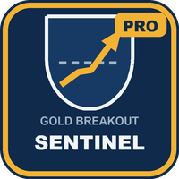
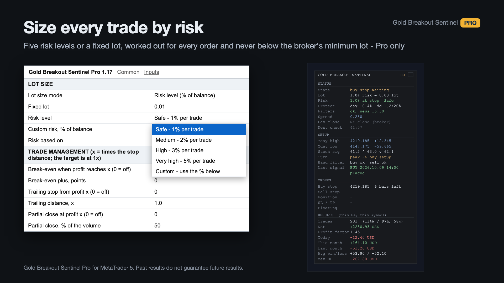
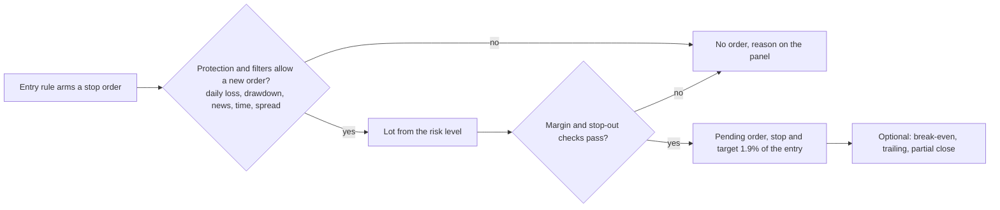
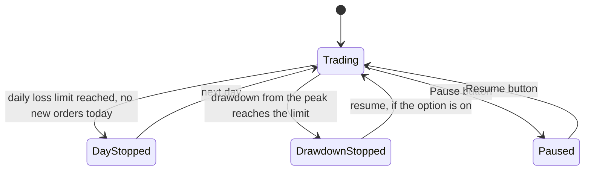
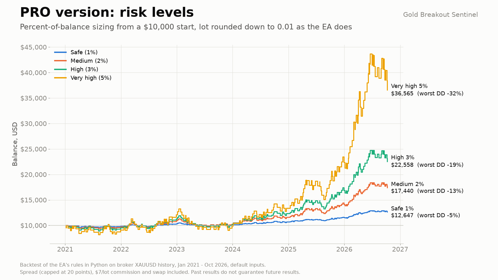
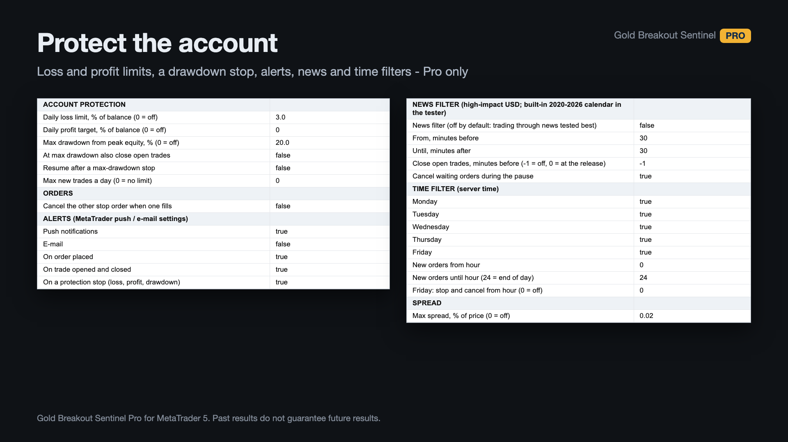
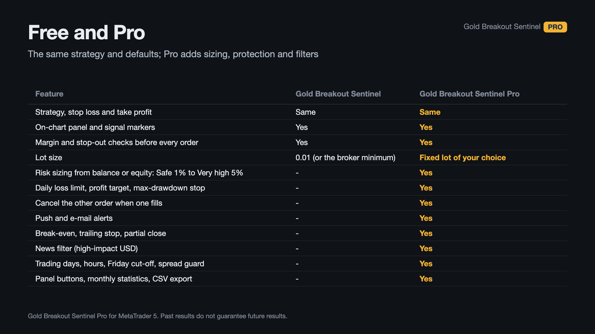
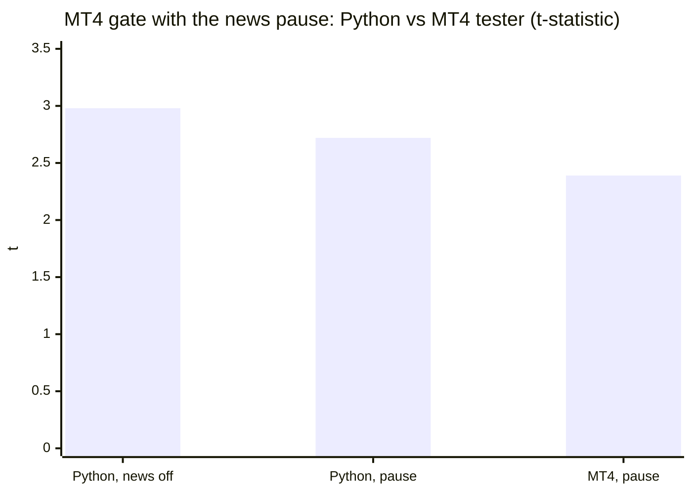

# Gold Breakout Sentinel Pro (MetaTrader 5 and MetaTrader 4)

An Expert Advisor that trades **XAUUSD on the H1 chart** around a daily breakout entry, and adds risk-based position sizing, account
protection and news, time and spread filters, plus trade management, panel buttons and push alerts. Rules-based, not a profit promise:
**my own tests found no proven edge** (see [Honest limits](#honest-limits)).

> **This is a showcase repository: documentation and images only. There is no source code here.** The product is distributed only
> through the MQL5 Market. The entry rule is that of the free edition, which has its own showcase repository:
> [allanninal/gold-breakout-sentinel](https://github.com/allanninal/gold-breakout-sentinel).

**Website:** [allanninal.dev/mql5/gold-breakout-sentinel](https://www.allanninal.dev/mql5/gold-breakout-sentinel/) · [MT4 editions](https://www.allanninal.dev/mql5/#mt4) · [allanninal.dev](https://www.allanninal.dev)
· **Contact:** message me on [LinkedIn](https://www.linkedin.com/in/allanninal/).

## Get it on the MQL5 Market

| Product | Platform | Price | Link |
|---|---|---|---|
| **Gold Breakout Sentinel Pro** | MT5 | paid | <https://www.mql5.com/en/market/product/200903> |
| **Gold Breakout Sentinel Pro MT4** | MT4 | paid | MT4 edition: coming soon on the MQL5 Market |
| Gold Breakout Sentinel | MT5 | free | <https://www.mql5.com/en/market/product/200385> |
| Gold Breakout Sentinel MT4 | MT4 | free | MT4 edition: coming soon on the MQL5 Market |

The Pro edition is standalone: you do not need to install the free one. Details, current price and the Strategy Tester demo are on the
Market pages.

## What it does

- **The entry (same as the free edition):** a stochastic turn plus a Bollinger Band filter arms a buy stop at yesterday's high or a sell
  stop at yesterday's low. Stop and target are 1.9% of the entry price each. Unfilled orders are deleted after 9 bars. No grid, no
  martingale, no averaging. Gold only; on other live or demo charts it stays idle.
- **Position sizing:** a risk level (Safe 1%, Medium 2%, High 3%, Very high 5% lost if the stop is hit, or a custom percent), based on
  balance (default) or equity. The lot is worked out per order from the stop distance, never below the broker's minimum. A fixed lot is
  also available.
- **Protection:** a daily loss limit (3% of the day's starting balance) and a maximum-drawdown stop (20% from peak equity, optionally
  closing open trades) are on by default; a daily profit target and a trade limit are optional.
- **Filters:** a news filter (off by default) that pauses new orders around high-impact USD events, can cancel waiting orders and close
  trades before the release, using the MetaTrader calendar (and a built-in 2020 to 2026 calendar in the Strategy Tester); a time
  filter (days, hours, Friday cut-off); a spread guard (no new order above 0.02% of the price).
- **Management:** optional break-even, trailing stop, partial close and cancel-other-order (all off by default); push and e-mail alerts
  (push on, e-mail off).
- **Panel:** Lot and Risk rows, protection status, active filters, next high-impact news, and buttons to cancel waiting orders, close the
  trade, pause or resume, and export trades to CSV.

### What the protection can do

| | |
|---|---|
|  |  |
|  |  |

More charts of the entry rule's backtest: [how a trade works](images/01-how-it-works.png), [results by year](images/04-results-by-year.png),
[statistics](images/06-statistics.png). They are drawn by a script from a Python reproduction of the rules on broker history; they are
illustrations, not terminal captures.

## Who it is for

Traders who want to size gold breakout trades by risk with guard rails, and will test on demo first. **Not** for anyone expecting a proven
result, other symbols, or a signal indicator. For a fixed 0.01 lot, the free
[Gold Breakout Sentinel](https://www.mql5.com/en/market/product/200385) is enough.

## Why it was built

- **To size and guard a simple rule, not to sell an edge.** The free edition fixes the lot at 0.01; Pro is for traders who want a risk
  level, loss limits and filters around the same entry.
- **Weak evidence, stated plainly.** The settings lost money over 2009 to 2020 and the rules were not profitable on 36 other symbols; the
  good years are recent. Higher risk levels multiply losing streaks as well as gains.
- It pairs with the free edition and uses the same defaults.

## Results of the checks

Python reproduction of the rules (not a Strategy Tester run), XAUUSD H1 broker history, January 2021 to October 2026, from 10,000 USD,
default inputs, spread (capped at 20 points), USD 7 per lot commission and swap included, lot rounded down to 0.01 as the EA does.

| Risk level | Risk per trade | Final balance | Worst balance drawdown, 2021 to 2026 | Worst, 2009 to 2026 |
|---|---:|---:|---:|---:|
| Safe | 1% | 12,647 USD | 5% | 19% |
| Medium | 2% | 17,440 USD | 13% | 39% |
| High | 3% | 22,558 USD | 19% | 56% |
| Very high | 5% | 36,565 USD | 32% | 79% |

```mermaid
xychart-beta
    title "Worst balance drawdown by risk level, % (backtest)"
    x-axis ["Safe 1%", "Medium 2%", "High 3%", "Very high 5%"]
    y-axis "%" 0 --> 80
    bar [5, 13, 19, 32]
    bar [19, 39, 56, 79]
```

(First series 2021 to 2026, second series 2009 to 2026.) The settings lost money over 2009 to 2020 (profit factor 0.94); 2021 to 2026 was the
strategy's best period. Start with Safe.

| Check | Result |
|---|---|
| Release check, builds 1.15 and 1.16: validation-style runs | no error lines |
| Non-repainting | 400 signals identical between every-tick and 1-minute OHLC models |
| News options (1.17), Python and MetaTrader tests, 2020 to 2026 | the result with the filter off was higher than with pauses or closing before news; hence it is off by default |
| MT4 publish gate, Python half: entries 2023-07-01 to 2026-09-30, news pause on (138 trades) | mean R +0.228, t 2.72, PF 1.59 (news off: 139 trades, +0.247, t 2.98, PF 1.66) |
| MT4 publish gate, MT4 Strategy Tester half (every tick, two spread chunks), news pause on | 141 trades vs 138, signals 1700 of 1703, mean R +0.197, t 2.39, PF 1.50, halves +0.081 / +0.275 |
| MT4 validator-style runs | 10 of 10 runs, 0 error lines (free and Pro) |

The gate criteria were written before any number was computed (at least 40 trades; mean R > 0 and t >= 2.0; profit factor >= 1.20; both halves
positive; a news-pause run still positive). This is one test of one pre-existing setting with no search, so a pass means "not rejected on this
window", and the listing claims no profit. The MT5 edition was published before the gate existed.

## Honest limits

- **No proven edge.** The rules lost money over 2009 to 2020; the good years are recent; a Python reproduction is not a live record.
- **Higher risk levels multiply losing streaks too.** The 2009 to 2026 drawdowns above are the honest guide, not the 2021 to 2026 ones.
- **News handling:** the live filter reads the terminal's calendar, which differs from the built-in list used in the tester; the filter did not
  improve the backtest, so it is off by default.
- **Gold only, H1, defaults;** other settings are not tested. Keep the terminal running, or use a VPS.
- The source is not published; this repository documents what the product does and the results of its checks.

## Free vs paid

| | Gold Breakout Sentinel (free) | Gold Breakout Sentinel Pro (paid) |
|---|---|---|
| The entry rule and the fixed stop and target | yes | yes |
| Lot | fixed 0.01 (or the broker minimum) | risk levels or a fixed lot |
| Account protection, news, time and spread filters, trade management, panel buttons, alerts | no | yes |
| MT5 | [200385](https://www.mql5.com/en/market/product/200385) | [200903](https://www.mql5.com/en/market/product/200903) |
| MT4 | coming soon | coming soon |

---

**Website:** [allanninal.dev/mql5/gold-breakout-sentinel](https://www.allanninal.dev/mql5/gold-breakout-sentinel/) · [MT4](https://www.allanninal.dev/mql5/#mt4) · [allanninal.dev](https://www.allanninal.dev)
· Questions: message me on [LinkedIn](https://www.linkedin.com/in/allanninal/). All rights reserved, see [LICENSE](LICENSE).
